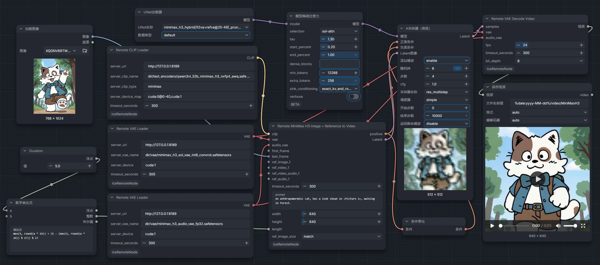

# ComfyUI-IceRemoteNode

Run CLIP and VAE in remote machine(s).

# Install

Both machines install ComfyUI.

Clone this repository into `ComfyUI/custom_nodes` for each instances.

That's it.

# Nodes

- Remote CLIP Loader
- Remote VAE Loader

Special nodes for MiniMaxH3:

- Remote/Local MiniMax H3 Image + Reference to Video
- Remote VAE Decode Video

# Notice

**All nodes use standard http without encryption**.

If you need to protect the transfer data, you may need a proxy.

# Acknowledgement

The `MiniMax H3 Image + Reference to Video` node use the following code to support FL2V and Ref2V (Hybrid) model at once:

[ComfyUi-MiniMax-H3-Image-And-Reference-To-Video](https://github.com/BigStationW/ComfyUi-MiniMax-H3-Image-And-Reference-To-Video)